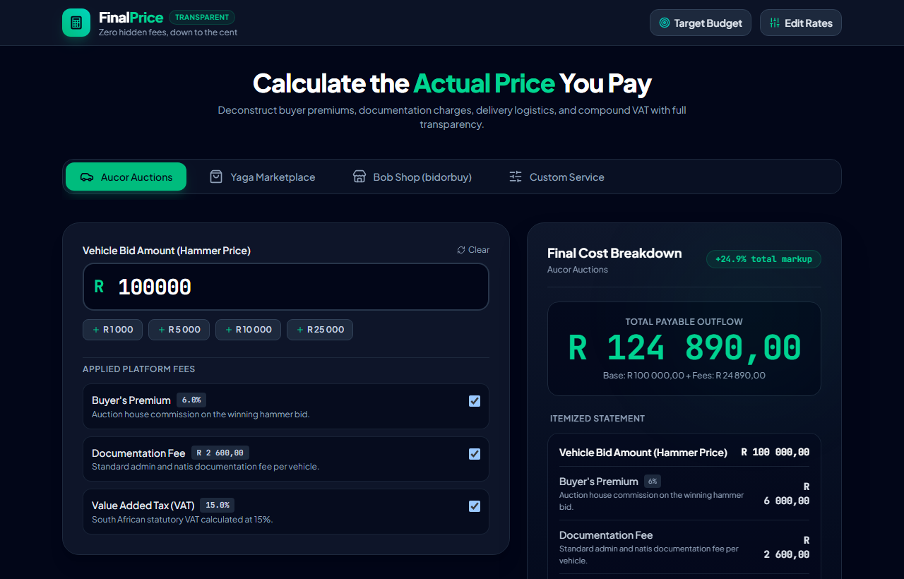
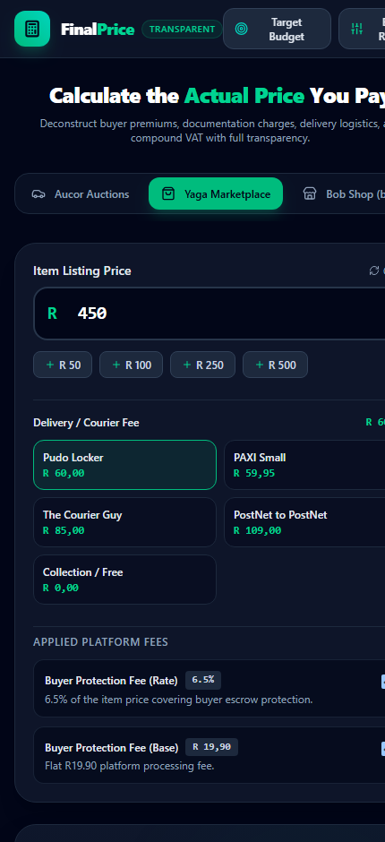

# FinalPrice

A high-performance, mobile-first web app that deconstructs the actual total cost of purchases across auction houses, marketplaces, and service platforms with zero hidden surprises.

## Demonstration & Preview

### Desktop View: Aucor Vehicle Auction Calculation


### Mobile View: Yaga Marketplace Checkout
<p align="center">
  
</p>

## Supported Platforms & Calculators

- **Aucor Vehicle Auctions**: Calculates `(Bid Amount + 6% Buyer's Premium + R2,600 Documentation Fee) + 15% VAT`. Includes quick bid increments (+R1k, +R5k, +R10k, +R25k).
- **Yaga Marketplace**: Calculates `6.5% Buyer Protection Fee + R19.90 Base Fee + Courier/Delivery Fee + Item Listing Price`. Includes shipping presets (Pudo, PAXI, Courier Guy, PostNet, Free Collection).
- **Bob Shop (Bidorbuy)**: Calculates buyer guarantee and shipping options.
- **Custom Service**: Fully configurable formula pipeline (commission percentage, handling fee, delivery, and tax).
- **Target Budget Solver (Reverse Calculator)**: Enter your maximum total budget (e.g. R100,000) and FinalPrice solves for the maximum winning bid you can place without exceeding your bank balance.
- **Editable Fee Schedules**: Values are not hardcoded. Users can edit any fee rate or flat amount with instant persistence in `localStorage` and a 1-click restore to platform defaults.

## Tech Stack & Architecture

- **Framework**: [React 19](https://react.dev/) + [Vite](https://vite.dev/) + [TypeScript](https://www.typescriptlang.org/)
- **Styling**: [Tailwind CSS v4](https://tailwindcss.com/) with [Plus Jakarta Sans](https://fonts.google.com/specimen/Plus+Jakarta+Sans) & [JetBrains Mono](https://fonts.google.com/specimen/JetBrains+Mono)
- **Icons**: [Lucide React](https://lucide.dev/)
- **Testing**: [Vitest](https://vitest.dev/)
- **Deployments**: Configured for instant deployment on [Vercel](https://vercel.com/) and [Netlify](https://www.netlify.com/).

## Getting Started

### Prerequisites
- Node.js (v18+)
- npm (v9+)

### Installation
```bash
git clone https://github.com/ENM032/FinalPrice.git
cd FinalPrice
npm install
```

### Development Server
```bash
npm run dev
```

### Run Tests
```bash
npm test
```

### Production Build
```bash
npm run build
```

## Deployment

### Deploy to Vercel
Push your repository to GitHub, import it into Vercel, and click **Deploy**. The included `vercel.json` automatically configures SPA rewrites and security headers.

### Deploy to Netlify
Import your repository into Netlify. The included `netlify.toml` automatically configures build settings, SPA redirects, and security headers.

## Security & Privacy
- **100% Client-Side**: All calculations and reverse budget optimizations run locally on your device.
- **Zero Tracking**: No user financial bids or inputs are sent to any remote server or third-party service.
- **Strict Headers**: Hardened with standard CSP, `X-Frame-Options: DENY`, and `X-Content-Type-Options: nosniff`.
